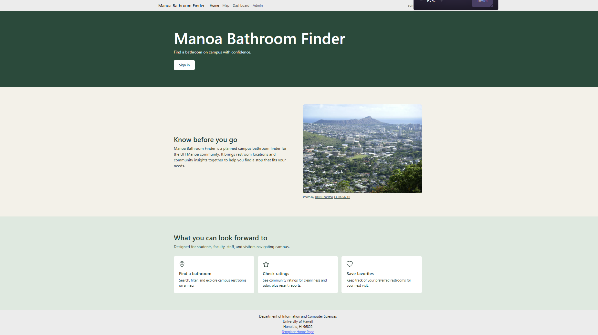
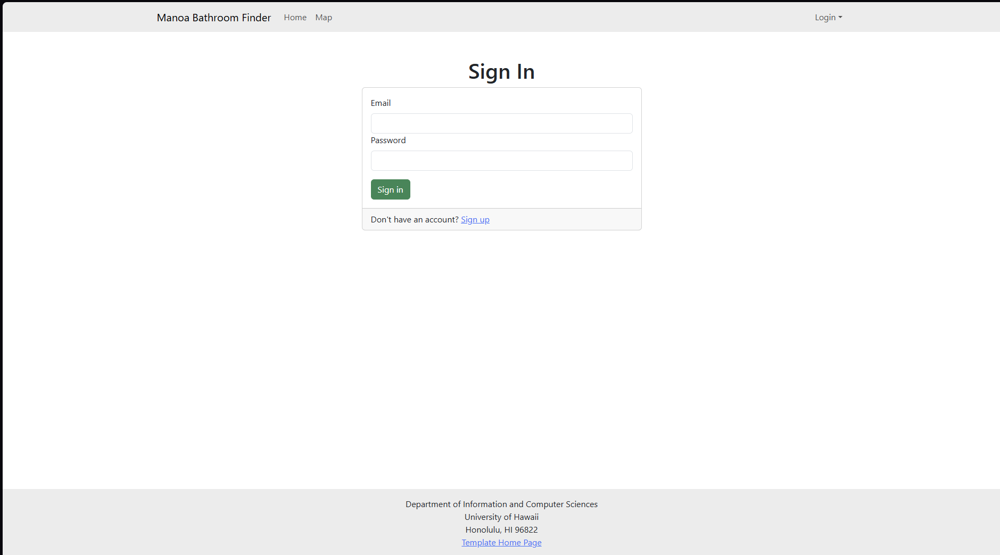
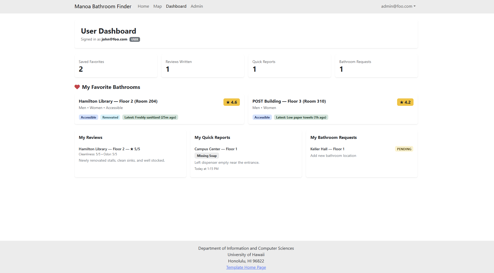
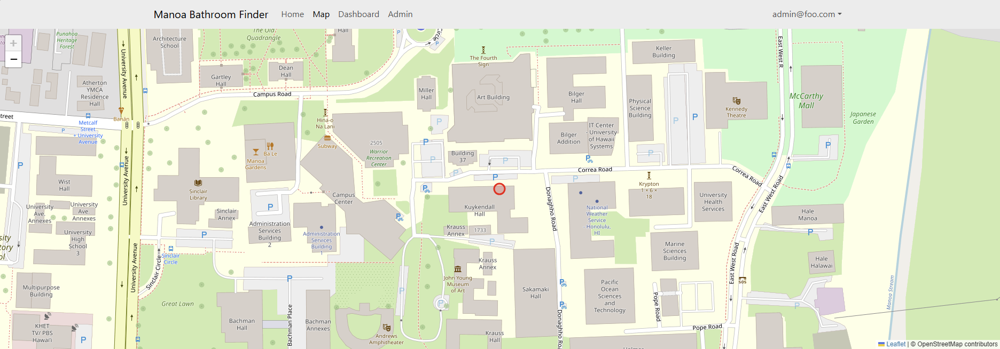
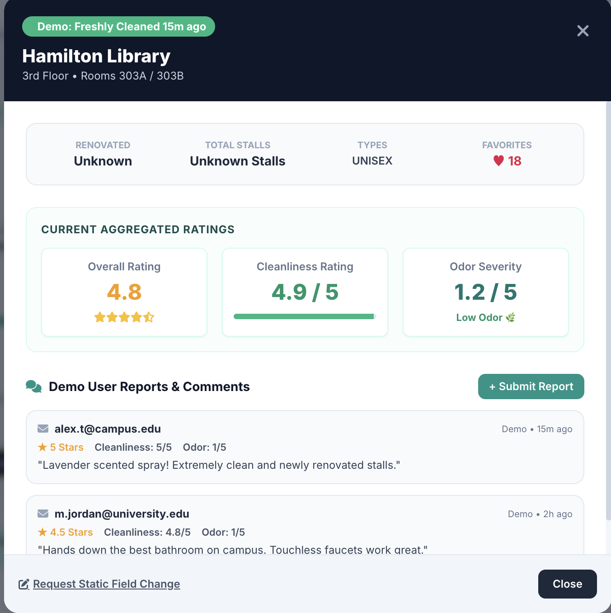
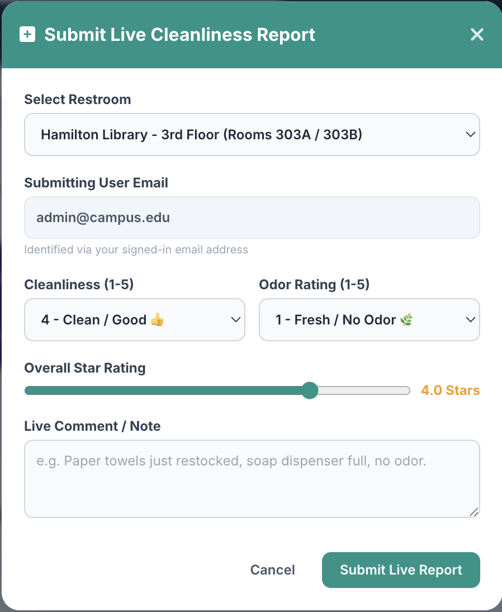
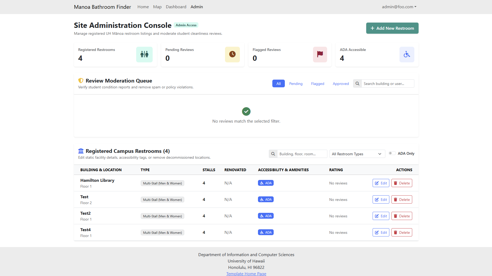

# manoa-bathroom-finder

## Table of contents

* [Overview](#overview)
* [Deployment](#deployment)
* [Milestones](#milestones)
* [User Guide](#user-guide)
* [Community Feedback](#community-feedback)
* [Developer Guide](#developer-guide)
* [Development History](#development-history)
* [Continuous Integration](#continuous-integration)
* [Walkthrough videos](#walkthrough-videos)
* [Example enhancements](#example-enhancements)
* [Team](#team)

## Overview

manoa-bathroom-finder is a web application that helps UH Manoa students find and compare campus bathrooms. Students can search for a bathroom, view its location and details, read reviews, and submit updates about its current condition.

The project addresses a simple problem: students often do not know whether a bathroom is clean, crowded, missing supplies, or accessible before they use it.

The planned system includes:

* A bathroom directory with locations, restroom types, stall counts, renovation dates, and accessibility information.
* Community ratings for cleanliness, odor, and overall experience.
* Recent reports for conditions such as missing soap, missing toilet paper, high odor, or long lines.
* Search, filters, an interactive map, favorites, and an administrator review queue.

The current prototype is built with HTML, CSS, and JavaScript. It uses Tailwind CSS, Font Awesome, Google Fonts, and Leaflet through CDNs.

## Deployment

The manoa-bathroom-finder project home page is deployed at [manoa-bathroom-finder.github.io](https://manoa-bathroom-finder.github.io/).

[Open the deployed application on Vercel](https://manoa-bathroom-finder.vercel.app/).

The application source is available in the [manoa-bathroom-finder repository](https://github.com/manoa-bathroom-finder/manoa-bathroom-finder).

- [GitHub organization](https://github.com/manoa-bathroom-finder)
- [Documentation repository](https://github.com/manoa-bathroom-finder/manoa-bathroom-finder.github.io)

## Milestones

### Milestone 1

The [M1 Project board](https://github.com/orgs/manoa-bathroom-finder/projects/2) tracks the first release, including completed issues and their estimated and actual effort.

### Milestone 2

The [M2 Project board](https://github.com/orgs/manoa-bathroom-finder/projects/5) tracks planned work for the second release.

## User Guide

### Landing Page

Manoa Bathroom Finder provides UH Manoa students with an easy way to locate and compare campus bathrooms. Users can explore restroom locations, check community ratings and recent condition reports, and find bathrooms that best fit their needs.

### Sign-in Page

The sign-in page uses a standard login interface where users can enter their email and password to access their account.

### Bathroom Directory

The directory lets students search by building, floor, or room number. Filters can be used to find highly rated, accessible, renovated, or recently reported bathrooms.

### Interactive Map

The map displays restroom locations across campus. Selecting a location shows its details and allows the student to inspect or report its condition.

### Bathroom Details

The details view shows the restroom type, stall count, renovation date, accessibility information, favorites, ratings, and recent community reports.

### Reviews

Students can submit an overall star rating, cleanliness score, odor score, supply checks, tags, and a written comment. The review prototype also includes a preview of the post before it is submitted.

### Quick Reports

Students can quickly report that a restroom was freshly sanitized, out of paper or soap, high odor, or crowded. They can also add a short note.

### Administration

Administrators will be able to review bathroom requests, data corrections, reviews, and condition reports before approving or rejecting them.

## Community Feedback

The project is intended to make it easier for students to find useful and current information about campus bathrooms. Feedback will help us decide which details are most useful, how reports should be moderated, and which filters students use most often.

## Developer Guide

The current prototype does not require a build step. The main prototype files are:

* `manoa-bathroom-finder-mockup.html` — bathroom directory, map, bathroom details, favorites, and admin queue.
* `campus_bathroom_rating_reviews.html` — ratings, reviews, quick reports, and the community feed.

The current mockup uses sample data in the browser. A production version will need a shared database, authentication, authorization, and permanent moderation.

## Development History

The project began as a proposal for a UH Manoa bathroom locator and tier list. The first prototypes focused on the main directory and map. Later work added detailed reviews, live condition reports, supply checks, community-feed filters, and administrator workflows.

The next major step is connecting the prototype to persistent application data so that students can see the same reviews and reports across devices.

## Continuous Integration

Continuous integration has not been added yet. A future GitHub Actions workflow will build the application and run checks for the front-end code.

## Walkthrough videos

Walkthrough videos have not been recorded yet. A future walkthrough will demonstrate searching for a bathroom, inspecting its details, submitting a review, and posting a quick condition report.

## Example enhancements

* Add directions and building hours.
* Add notifications for favorited bathrooms.
* Add charts showing cleanliness and odor over time.
* Add a transparent bathroom tier list.
* Add moderation history and community guidelines.
* Allow facilities staff to respond to reports.

## Team

* [Haoshen Zheng](https://haoshenz.github.io/)
* Kainalu Ishikawa
* Mina Girgis
* Junhong Xiong

[Team Contract](https://docs.google.com/document/d/1HAmrxqY5iD_ex8r_4eDPRyNtqC99hyQi__yDae6Tv88/edit?usp=sharing)
